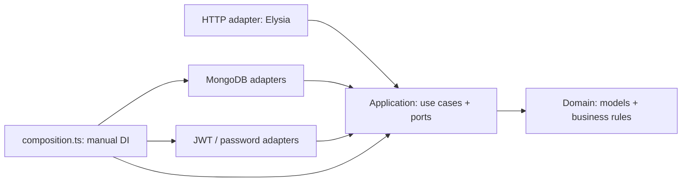

# Architecture

This is the implemented structure for the Phase 1 application. The refactor keeps
its HTTP contracts, permission rules, inventory constraints and MongoDB schema.
It introduces no new warehouse workflow or migration.

## Backend: Hexagonal Architecture

The application core describes the work and its required dependencies. Adapters
supply Elysia HTTP handling, MongoDB persistence, JWTs and Bun password hashing.
Dependencies point toward the core:



```text
backend/src/
  inventory/
    domain/              Models, calendar dates, field validation and normalization
    application/         Product/lot/location use cases, commands, views and ports
    adapters/
      http/              Routes and request schemas
      mongodb/           Collections, mapping, repositories and unit of work
  auth/
    domain/              User/session models and public-user projection
    application/         Login, refresh, logout, authentication and dependency ports
    adapters/
      http/              Cookies, Bearer headers, auth routes and rate limiting
      mongodb/           Atomic session rotation and user/session repositories
      security/          JWT signing/verification and Bun password hashing
  shared/
    domain/              Actor identity and transport-independent application errors
    application/         Clock and ID-generation interface
    adapters/http/       HTTP status mapping and Bearer parsing
  composition.ts         Chooses and injects all concrete core dependencies
  app.ts                 Composes HTTP adapters and common HTTP policies
  database.ts            Connection lifecycle and migration readiness
  index.ts               Production startup/shutdown
```

For a Spring Boot reader, these roles map as follows. They do not require an
additional class or base class for every row:

| Familiar role | Here | Responsibility |
| --- | --- | --- |
| Controller | `*/adapters/http/routes.ts` | Read/validate HTTP input and invoke a use case |
| Service | `*/application/` | Coordinate business rules, authorization and atomic work |
| Entity | `*/domain/models.ts` | Express business data without driver/framework types |
| Repository interface | `*/application/ports.ts` | Describe persistence operations needed by use cases |
| Repository/DAO implementation | `*/adapters/mongodb/` | Own Mongo filters, sessions and record mapping |
| DTO | Commands and views under `inventory/application/` | Define input and returned application data; HTTP schemas validate wire input |
| DI configuration | `composition.ts` | Construct adapters and pass them into use-case factories |

DI is explicit function-argument injection. The composition root connects ports to
adapters; TypeScript checks those interfaces. No runtime container or decorators
are required. `createAuthUseCases` and `createInventoryUseCases` can be constructed
without MongoDB or Elysia; production and integration tests choose real adapters
through the same composition root. There is no generic base repository or second
DAO layer duplicating the repository implementation.

### Example: creating a product

1. The HTTP adapter authenticates the Bearer token and validates the body.
2. `application/products.ts` checks the actor's role and normalizes product fields
   through domain rules.
3. `InventoryUnitOfWork.run` executes the change using transaction-scoped ports.
4. The Mongo adapter opens the session; repository methods and `recordEvent` all
   share it. Mongo types and query operators stay inside the adapter.
5. Product, audit and the original idempotent response commit together. An
   identical retry returns that response without applying another change.

Update use cases still acquire the product/lot/location write before checking
related state. Optimistic revisions, first-receipt locks, historical-pallet
fallbacks, duplicate-code conflicts and rollback behavior are preserved. New stock
writers must acquire those same writes; a repository abstraction does not replace
that concurrency protocol. `id` is the application identity; Mongo adapters map it
to `_id`, preserving existing stored documents.

`ApplicationError` carries an error kind/code/message. The HTTP adapter maps kinds
to the existing status codes and error envelope. Auth use cases receive raw tokens;
Bearer headers, refresh cookies, trusted origins and rate limits belong to HTTP.
The security adapter retains JWT claims/algorithm checks and the dummy password
verification cost for unknown users.

## Frontend: Atomic Design with feature ownership

Atomic Design describes UI composition. Network access, business data and hooks
remain owned by features; they do not become atoms or molecules.

```text
frontend/src/
  components/
    atoms/               CalendarInput, ActiveStatusTag, AbcTag
    molecules/           PageHeading, SearchToolbar, RecordActions
    organisms/           FormDialog, ChangeHistoryDrawer, WorkspaceNavigation
    templates/           LoginTemplate, WorkspaceTemplate, MasterDataTemplate
  features/
    auth/                Session/API client, login form, account panel and role labels
    master-data/
      api/               HTTP calls and localized API failures
      hooks/             Catalog/history loading and idempotent save state
      components/        Product/lot/location forms, editors, tables and history wiring
      types.ts           Feature DTOs
    abc/                 Demo model, workbench, analysis controls/table and location panel
    users/               User-list loading and display
  pages/                 Login, workspace and master-data page composition
  theme/                 Ant Design tokens (the existing Clear Blue theme)
  App.tsx                Providers and session routing
```

Ant Design already supplies primitive buttons, text inputs and tags. We reuse
those primitives directly; local atoms encapsulate application-specific semantics
such as a string-valued calendar input. Molecules combine primitives for a small
interaction. Organisms combine interactions into a form dialog, history drawer or
navigation. Templates place those larger parts into a layout; pages supply real
feature data and actions.

Feature-specific tables and editors are organisms kept inside their owning
feature rather than a shared component directory. Their form-field groups are
feature-specific molecules. A product table receives products and callbacks; the
page chooses which record to edit. This avoids turning the shared design system
into a dependency on inventory DTOs.

For example, `ProductEditor` supplies fields and save behavior to
`MasterDataEditor`. Its hook retains the idempotency key when retrying unchanged
values and translates API failures. Shared `FormDialog` only renders the form,
loading state, translated error and action callbacks. Likewise `useHistory` loads
history; `ChangeHistoryDrawer` receives events and field labels as props.

The auth API client remains the shared authenticated-request entry point used by
features. Session refresh/rotation serialization, automatic mutation retry and
cross-tab sign-out behavior are unchanged. The ABC model remains an explicitly
marked demo, separate from persistent master data.

## Rules for later work

- Backend domain imports only domain code. Application imports its own or shared
  application/domain code. Driver, security and HTTP libraries stay in adapters.
- Add a port for an actual outside dependency, using operations the use case
  needs. Do not expose Mongo filters, cursors or sessions in a port.
- Shared frontend components receive props and callbacks. They cannot import a
  feature, page or feature API. Features cannot import pages.
- Atoms do not import larger compositions; molecules do not import organisms or
  templates; organisms do not import templates. Ant Design is the primitive UI
  library, not another collection of local forwarding wrappers.
- Keep domain-specific forms/tables near their feature. Extract shared UI when
  its behavior is reusable, not merely because two files have similar length.
- Preserve the established HTTP, migration and browser tests through refactors.
  Test persistence/concurrency with isolated real MongoDB replica sets.

Run `yarn check:architecture` in either package. The shared TypeScript-AST checker
checks imports, re-exports, literal dynamic imports, import types and literal
`require` calls against these dependency rules. It is an import guard, not a
semantic proof of every architectural property; code review still checks that a
port has the right responsibility. No dependency/container package was added.

## Sources and decisions

[Alistair Cockburn's original Hexagonal Architecture article](https://alistair.cockburn.us/hexagonal-architecture)
explains keeping the application independent of outside adapters and substituting
adapters through ports. Our feature-first folders, manual DI and transaction port
are implementation choices for this repository.

[Brad Frost's Atomic Design methodology](https://atomicdesign.bradfrost.com/chapter-2/)
defines atoms, molecules, organisms, templates and pages. Combining that hierarchy
with feature-owned hooks/API code and the existing Ant Design primitives is our
repository-specific application of the methodology.

## Refactor validation

- Backend: `yarn typecheck`, `yarn check:architecture` and `yarn test` passed
  (63 tests, including auth, inventory, migration and demo-command regressions).
- Frontend: `yarn typecheck`, `yarn check:architecture`, `yarn test` (13 tests)
  and `yarn build` passed.
- `PLAYWRIGHT_CHANNEL=chrome yarn test:e2e` passed all five existing browser
  flows, including persistent master-data edits/history, staff permissions,
  cross-tab auth and mobile ABC/navigation behavior.
- The architecture checker was also exercised with temporary forbidden imports
  in a backend domain module and a frontend atom; both were rejected and removed.
- Independent standards and behavior reviews found no material issues.
- Tests used isolated local databases. No migration or seed was run against the
  application database. The existing large-bundle Vite warning remains.
